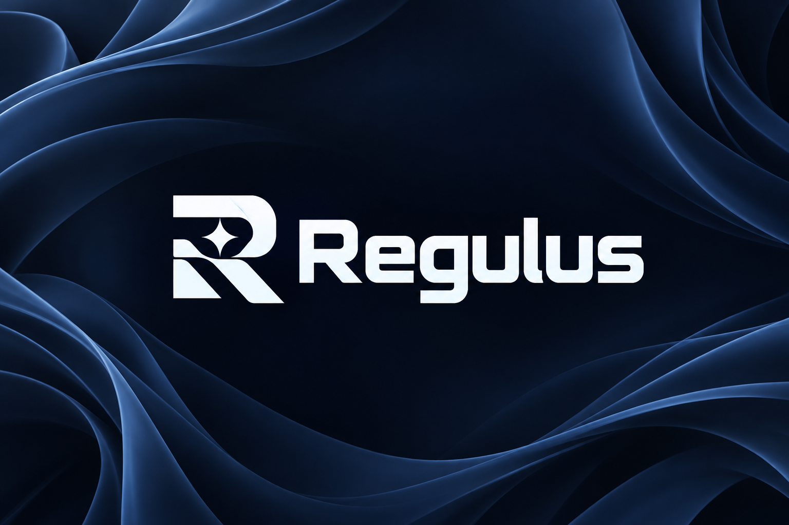
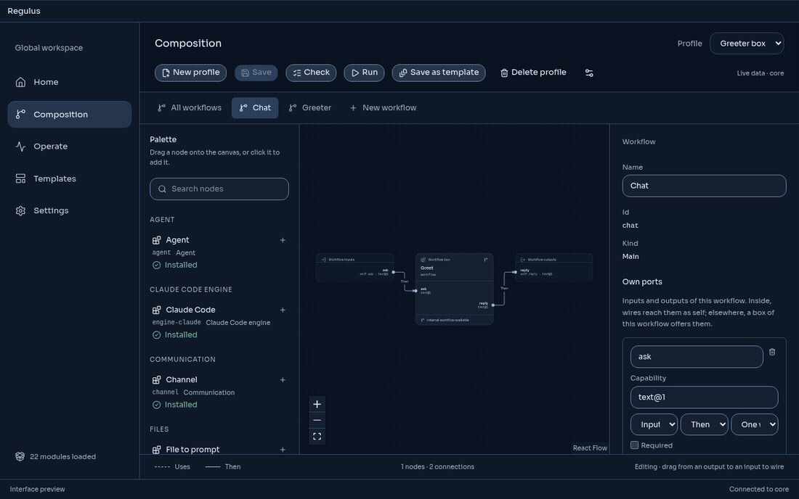
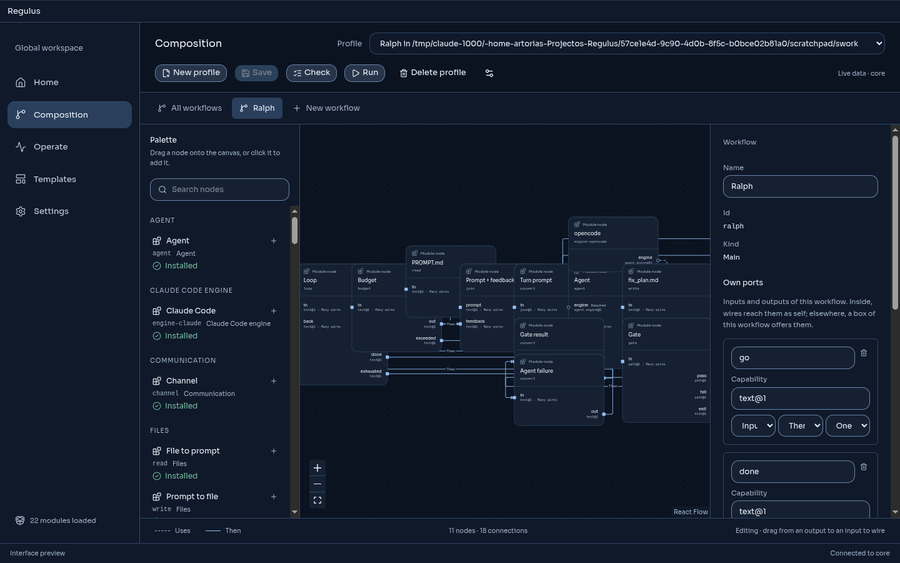
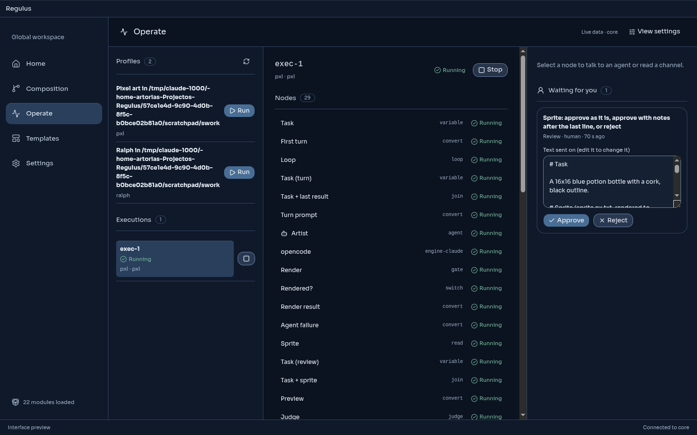
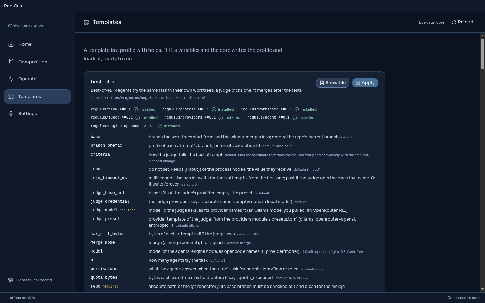
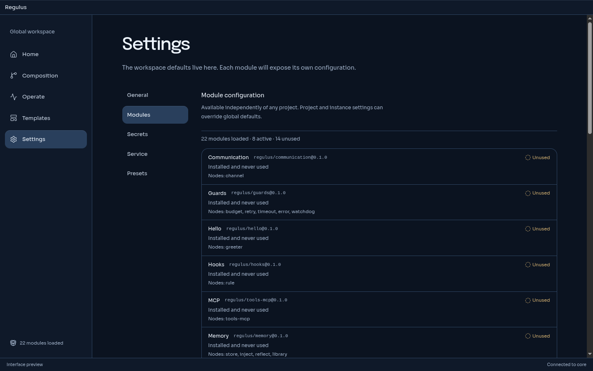
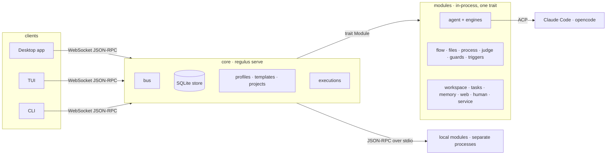
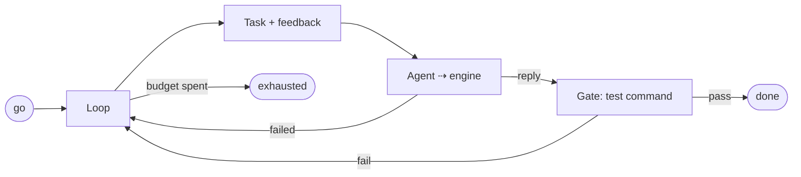

# Regulus

[](https://github.com/Solar2004/Regulus/actions/workflows/ci.yml)



> A module host with a visual interface for building, wiring and operating systems of
> AI agents. It absorbs outside code and makes it its own, without losing the ability
> to remove it.

The product is not the feature list. It is being able to add and remove features
without anything breaking. Every module can be taken out and the rest keeps working,
and that is verified by a test on every push, not promised.

**Development status (2026-11-09):** the core, CLI, desktop app and TUI work end to
end. Release 0.2.0 includes reusable boxes with capability inputs, workflow
conversation, managed workers, document retrieval, evaluation and a native agent
engine alongside Claude Code and opencode. Regulus Code, described below, is being
developed in the current checkout and is not included in 0.2.0. Contributor guides are in
English; the detailed design record is currently in Spanish.

---

## Download

Linux x86_64 builds are available from [GitHub Releases](https://github.com/Solar2004/Regulus/releases/latest).

| Package | Download |
|---|---|
| Desktop AppImage | [Regulus 0.2.0 AppImage](https://github.com/Solar2004/Regulus/releases/download/v0.2.0/Regulus_0.2.0_amd64.AppImage) |
| Debian / Ubuntu | [Regulus 0.2.0 .deb](https://github.com/Solar2004/Regulus/releases/download/v0.2.0/Regulus_0.2.0_amd64.deb) |
| CLI and TUI | [Linux executable](https://github.com/Solar2004/Regulus/releases/download/v0.2.0/regulus-linux-x86_64) |

The release includes checksums and a signed update manifest. For AppImage or the CLI,
make the downloaded file executable with `chmod +x <file>` before running it.
Agent engines such as Claude Code and opencode are installed separately.

Want to help build Regulus? Start with [CONTRIBUTING.md](CONTRIBUTING.md), the
[English concept guide](docs/contributing/concepts.md), and the
[module development guide](docs/contributing/modules.md).

## A workflow in 25 seconds



Recorded against a real local core using the deterministic Greeter example. This
shows composition and workflow conversation; it does not use an AI model or show
an autonomous coding run. These composition and conversation features are included
in 0.2.0.

## Regulus Code (development)

A coding harness made from Regulus nodes, with a focused terminal interface and a
Code view in the desktop app. Both clients use the same core executions, agent
conversation, tool activity and permission decisions.

```sh
regulus code /absolute/path/to/project --preset ollama --model your-installed-model
```

Use an endpoint and model you already have; this command does not download a model.
The desktop setup offers the same provider settings. The coding module supplies
file reading and search, exact-match edits, file creation, command execution and Git
inspection. The default harness asks before edits and commands; its workers start
with read-only tools.

Open the profile in the canvas to replace the engine, change its tools and rules,
connect other workflows, or save your own template. Workspace, filtered tool views and
repository instructions are reusable nodes outside this harness. The small stellar lion is
defined in an [editable shared grid](assets/design/regulus-code-mascot.json).

See the [coding harness design and limits](docs/14-code.md) for the supported surface.
The command tool runs host processes: its working directory is not a sandbox.

## The app

**Composition.** Workflows are drawn on a canvas. The palette on the left lists every
node the loaded modules offer; the panel on the right edits the selected node or the
workflow's own ports. Dashed wires are *uses* (a capability offered to a node), solid
wires are *then* (a value travelling from an output to an input). This is the Ralph
template, loaded from the core.



**Operate.** Profiles to run, executions with the state of every node, and the
decisions that wait for a person. Here the pxl template has drawn a sprite and asks
for a review: approve as it is, edit the text to send notes back, or reject.



**Templates.** Each template declares the modules it needs, its holes with defaults,
and installs from a form.



**Settings.** Modules, secrets, the service endpoint, provider presets and updates.



The same operations exist in the TUI (`regulus` with no subcommand) and as CLI
commands. The app is a client like the other two: it never does anything the core
cannot do alone.

## How it works



- **Modules** are Rust crates loaded in-process behind one trait. They declare nodes
  with typed ports. The core never knows a module by name, only by capability.
- **Nodes** are placed in a **workflow** and joined by two kinds of wire: *uses* and
  *then*. A workflow is itself a box with ports, so workflows nest.
- A **profile** is the saved set of workflows. An **execution** is a profile running:
  its events go over the bus and are stored in SQLite, and the CLI, TUI and app read
  the same stream.
- The **Agent box** runs a coding agent over the Agent Client Protocol, with its own
  provider, skills, hooks, isolated profile and secrets. Agents in one execution talk to
  each other through an MCP tool.
- **Templates** are profiles with holes. `regulus template apply` fills the holes and
  writes a copy you own. Known agent systems are data, not code.
- **Projects** are folders with a `regulus.toml`: their own profiles, templates and
  local modules, which run as separate processes over JSON-RPC and only when the
  project is trusted.

### A workflow, end to end

Ralph, the simplest template: a loop that gives an agent a task, lets it work, checks
the result with a command, and feeds the failure back until it passes or the budget
runs out.



Every box in that picture is a node from a module. Replace the engine and the agent
runs on another CLI. Replace the gate's command and it checks something else. Save it
as a template and it installs anywhere with holes for the parts that change.

## What ships

| Area | Modules |
|---|---|
| Agents | `agent` · `engine-claude` · `engine-opencode` · `providers` · `skills` · `hooks` · `tools` · `tools-mcp` · `communication` |
| Logic | `flow` · `files` · `process` · `judge` · `guards` · `triggers` |
| Environment | `workspace` · `tasks` · `memory` · `web` · `human` · `service` |
| Research and data | `documents` · `inference` · `evidence` · `data` |
| Example | `hello` |

| Template | What it builds |
|---|---|
| `ralph` | One agent, one loop, a test command as the gate |
| `sdd` | Spec-driven: constitution, spec, plan and tasks reviewed by a person, then implement until a check passes |
| `evaluator-optimizer` | A producer and a judge on separate providers, iterating |
| `best-of-n` | N agents in their own worktrees, a judge picks, tests gate the merge |
| `team` | A mayor splits work, two polecats deliver in their own worktrees, a witness and a refinery merge after tests |
| `research` | Plan, parallel sub-agents on the web, an experiment job, a report scored against a rubric |
| `chat-cli` | A chat CLI of your own: supervisor, system document, agents with and without tools |
| `pxl` | An agent draws pixel art as text, a renderer makes the PNG, a judge or a person reviews |
| `research-evidence` | An agent searches and reads the web, cites exact excerpts of versioned sources, and the report fails on any reference it cannot back |
| `rag-lab` | Two retrieval candidates on the same corpus and dataset, scored with the RAG evaluator and ranked |
| `topic-watch` | A timed or manual poll of a search or a page that reports only what is new, changed or gone since the last poll |

Each template documents its holes, its risks and the run that was made with a real
agent in its header.

## Build and run from source

Requirements: Rust stable, `pnpm` for the app, `python3` for a few templates, and the
CLI of at least one agent engine (`claude` or `opencode`).

```bash
cargo build -p regulus-cli
alias regulus=target/debug/regulus          # or wherever the binary lands

regulus serve                               # the core, in one terminal
regulus module ls                           # what is loaded
regulus template ls                         # what can be installed
regulus template apply ralph --set workdir=$PWD/some-folder
regulus run ralph --detach                  # exec-1  ralph  running
regulus send exec-1 go "Add a README to this folder."
regulus events --execution exec-1           # what the bus carried
regulus human list                          # decisions waiting for you
regulus                                     # the TUI, with no subcommand
```

The desktop app, against a core it starts itself:

```bash
cd crates/regulus-tauri/frontend
pnpm install
pnpm tauri:dev
```

Configuration lives in `~/.regulus/config.toml`: server, templates, secrets, client
settings, trusted projects, local module limits and the `[update]` table for signed
self-update. Every value has a default and nothing requires recompiling.

## Tests

```bash
cargo test --workspace                      # Rust suite, including the ablation matrix
cargo test -p regulus-cli --test ablation   # start without each module in turn
cargo clippy --workspace --all-targets      # zero warnings is the bar
cd crates/regulus-tauri/frontend && pnpm test   # vitest, the frontend
```

| Layer | Where | What it proves |
|---|---|---|
| Unit | each crate | Protocol types, parsing, the renderer of a template, signature checks |
| Integration | `crates/regulus-cli/tests/` | A real core over the socket: templates apply and wire up, local modules run only when trusted, `regulus update` installs a signed release and refuses a tampered one |
| Ablation | `crates/regulus-cli/tests/ablation.rs` | The core starts with each module removed and everything else still answers |
| Frontend | `frontend/src/**/*.test.ts` | Stores, settings, the update flow, the mock contract |
| Templates | `tests/template_*.rs` | Holes, wiring, and the deterministic parts run without an agent |

Runs with a real agent are not in the suite: they cost quota and minutes. Each
template records its last one in its header.

## Release and update

```bash
scripts/release.sh                          # dist/<version>/: binary, AppImage, deb,
                                            # SHA256SUMS, signed manifest, latest.json
scripts/release.sh --cli-only               # just the program
regulus update --check                      # what a user runs
regulus update                              # replace the binary with the newest signed one
```

The version lives in one place, `[workspace.package]` in `Cargo.toml`. Releases are
signed with a minisign-compatible Ed25519 key (`regulus update keygen`, `regulus update
sign`); the manifest binds every file by size and sha256. The CLI and the app's
Settings install only what that signature vouches for, only upgrade, and leave the
program untouched on any failure. Channels are folders under `[update] url`.

Regulus itself is published on GitHub Releases by `.github/workflows/release.yml`: every
`v*` tag builds, signs and uploads the files to the release `vX.Y.Z` and to the rolling
release named after the channel (`stable`), which is the folder `regulus update` and the
app read. The defaults of `[update]` already point there, so a fresh install updates
with `regulus update` or from Settings → Updates; `url = ""` turns it off.

## Git and hooks

```bash
scripts/install-hooks.sh     # once per clone: enables the hooks in .githooks/
```

Commits follow Conventional Commits: `type(scope): subject`, English, imperative, no
trailers. Three hooks enforce it: `commit-msg` validates the message against
[`.gitconventions`](.gitconventions), `pre-commit` scans for credentials and checks the
formatting, `pre-push` re-validates the whole range. The slow checks run in GitHub
Actions on every push and pull request
([`.github/workflows/ci.yml`](.github/workflows/ci.yml)): the Rust tests with the
ablation matrix, clippy and fmt; the frontend type check and vitest; the commit
messages and the secrets scan. Rules in [`docs/09-git.md`](docs/09-git.md).

## Repository layout

| Path | What |
|---|---|
| `crates/regulus-proto` | The protocol: JSON-RPC methods, manifests, graph types. The one version number that matters. |
| `crates/regulus-core` | Bus, store, profiles, executions, templates, projects, local modules as processes. |
| `crates/regulus-cli` | `regulus`: the server, every command, the TUI, `update`. Integration tests live here. |
| `crates/modules/*` | The modules, one crate each, with a `regulus-module.toml`. |
| `crates/regulus-tauri` | The desktop app: Tauri 2 shell and the React frontend. |
| `templates/` | The ready-made agent systems, as TOML. |
| `examples/local-modules/` | A project-local module in Python, run as a process. |
| `docs/` | The design documents, in Spanish. `AGENTS.md` is the map. |
| `harness/docguard/` | Rules that check changes against the docs. |
| `scripts/` | Hooks installer, commit lint, secrets scan, release. |
| `assets/` | Branding, design tokens, screenshots. |

## Principles

Five principles, each with a test it can fail: **flexible** (no literal that should be
configuration), **modular** (the ablation matrix passes), **fast** (measured, within
budget), **customizable** (changes without recompiling) and **infrastructure** (every
operation has a CLI command). The shape they take is the *liquid box*: fixed outside,
swappable inside. [`docs/00-principles.md`](docs/00-principles.md) is the full text and
it wins over every other document.

## Where to read next

| If you want to… | Read |
|---|---|
| Understand the model in plain words | [English concepts](docs/contributing/concepts.md) |
| Know what is decided and what comes next | [`docs/plan.md`](docs/plan.md) |
| Nodes, wires, workflows, profiles, projects | [`docs/11-composition.md`](docs/11-composition.md) |
| Agents, engines and providers | [`docs/12-agents.md`](docs/12-agents.md) |
| The logic blocks and the templates | [`docs/13-blocks.md`](docs/13-blocks.md) |
| The core and the workspace | [`docs/02-architecture.md`](docs/02-architecture.md) |
| Write a module | [`docs/03-modules.md`](docs/03-modules.md) |
| The clients: app, TUI, settings | [`docs/04-client.md`](docs/04-client.md) |
| Evidence and cited research | [`docs/15-evidence.md`](docs/15-evidence.md) |
| Datasets, RAG lab and topic watch | [`docs/16-experiments.md`](docs/16-experiments.md) |
| Drive Regulus from an MCP client (`regulus mcp`) | [`docs/17-control-mcp.md`](docs/17-control-mcp.md) |
| Dependencies and versions, release and update | [`docs/06-stack.md`](docs/06-stack.md) |
| Commit, branch, push | [`docs/09-git.md`](docs/09-git.md) |

**Agents working on this repo:** start with [`AGENTS.md`](AGENTS.md).

## Visual identity

The monogram joins an **R** with a four-pointed star, after the star Regulus. The app
icon sets the same stroke on a midnight blue rounded square. Logo and icon are
self-contained SVGs under `assets/branding/`; `python3 assets/branding/build_assets.py`
rebuilds the exports. The design direction, **Regulus Midnight**, with its palette and
tokens, is in [`docs/08-design-system.md`](docs/08-design-system.md) and
`assets/design/`.

## License

Regulus is licensed under [Apache-2.0](LICENSE). Third-party code retains its
applicable licenses and attribution; module origin metadata is kept in manifests.
