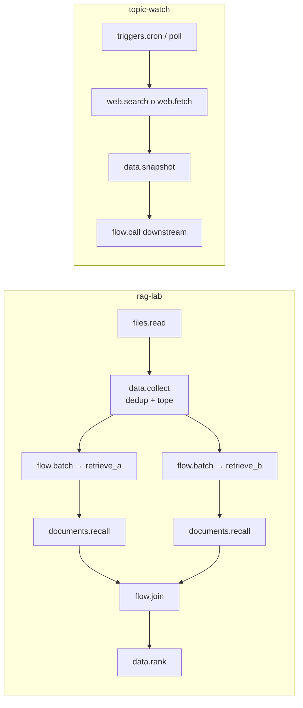

# 16 — Experimentos: el módulo `data`, el laboratorio RAG y la vigilancia de un tema

> **v1.0** · 2026-11-10 · ✅ construido. Módulo `regulus/data@0.1.0`
> (`crates/modules/data`), plantillas `templates/rag-lab.toml` y
> `templates/topic-watch.toml`, ejemplo `examples/research-lab/`.

Regla de alcance (`00-principles.md`, guardarraíl): se reutiliza `flow`, `files`,
`documents`, `web` y `triggers`; `data` solo añade lo que ninguno hacía y que el
laboratorio y la vigilancia piden. Nada de `data` sabe de RAG, de búsqueda ni de
investigación: son piezas de datos, y las plantillas las cablean.

## 1. El módulo `data`

Tres nodos, todos con manifest normal, entradas y salidas por el bus, `tool@1` por una
salida "usa" `tools` y los métodos del módulo para el CLI (`regulus call`).

| Nodo | Qué hace | Guarda estado |
|---|---|---|
| `collect` | Colección acotada de registros con clave. Un valor en `in` (JSON) o `text` es un registro, un array o texto (`text` = `record` · `json` · `jsonl`). La clave es el valor en `key_path` (puntero JSON `/id` o ruta con puntos); sin `key_path`, un hash del registro: los idénticos se funden. `flush` saca todo por `out`; `clear` vacía; `stored` resume cada entrada | sí |
| `snapshot` | Compara el estado actual de una fuente (array de registros) con el último guardado y lo guarda como nueva línea base: `added` · `changed` · `removed` · `unchanged`, por clave | sí |
| `rank` | Ordena métricas con clave (`{clave: métricas}` o array) por el número en `metric_path`: rangos con empate dentro de `tolerance` del primero de su grupo, distancia al mejor y a `baseline`, `labels`; con `scored_path` (p. ej. `/total`) solo compara si todas las entradas se midieron sobre el mismo número de elementos, al menos 1 | no |

**Contrato de datos.**

- *Clave* (`collect`, `snapshot`): texto, número o booleano; de `key_path`, o de la
  constante `key` (solo `snapshot`: seguir una sola cosa, p. ej. una página), o el hash del
  registro (blake2b-512, 128 bits en hex, sobre el JSON canónico con claves ordenadas: el
  mismo registro da el mismo hash sea cual sea el orden de sus claves).
- *Cambio* (`snapshot`): un registro con clave conocida es `changed` si el hash de lo que
  seleccionan `compare_paths` (todo si está vacío) difiere del anterior. El resto del
  registro puede variar sin ser noticia. Duplicados en una misma entrada: `keep_first` o
  `keep_last` y se cuentan.
- *Informe* (`snapshot.report`, siempre): `{snapshot, scope, seq, previous_seq, first,
  baselined, total, counts{added,changed,removed,unchanged,duplicates,rejected},
  added[{key,record}], changed[{key,record,before}], removed[{key,record}], rejected[]}`.
  `novel` (solo si hubo `added` o `changed`) es `[{change,key,record,before?}]` en el orden
  de llegada; `removed` solo si falta algo; `same` es el informe cuando no hay nada.
  `baseline = silent`: la primera entrada solo guarda la línea base y envía `report`.
- *Rechazos*: un registro sin clave, nulo, que no es JSON, mayor que `max_record_bytes` o
  que no cabe se rechaza y se **cuenta y nombra** (con número de línea en JSONL) en
  `stored.rejected` / `report.rejected` y en `error`; los demás se guardan. Un estado de
  `snapshot` que no cabe en `max_items`/`max_bytes`, o sin ningún registro con clave, se
  rechaza entero y la línea base se queda como estaba.
- *Entrada vacía* (`snapshot.on_empty`): `refuse` (defecto) convierte un array vacío (una
  búsqueda sin resultados, un 200 vacío) en error y deja la línea base; con
  `baseline = silent` tampoco guarda una línea base vacía. `accept` lo trata como estado
  real: todo lo anterior pasa a `removed`.
- *Registros ilegibles* (`snapshot.on_rejected`): con `keep_baseline` (defecto), si algún
  registro se rechaza, las entradas de la línea base que la entrada no repite se conservan
  (`counts.carried`) y no se dicen `removed`, para que no reaparezcan como `added` después;
  con `replace` la línea base sigue a lo legible. Coste: en esa entrada una baja real no
  se ve hasta una entrada limpia.

**Límites como campos del nodo** (`regulus-module.toml`): `max_items` (1000), `max_bytes`
(1 MiB, claves y registros en JSON compacto), `max_record_bytes` (64 KiB), `evict`
(`collect`: `refuse` rechaza lo que no cabe, `oldest` borra los más viejos), `history`
(`snapshot`, 20 ejecuciones con solo contadores), `max_results` (lo que devuelven las
herramientas). Un 0 vale el valor por defecto, nunca "sin tope".

**Estado.** Una fila JSON por colección o instantánea en el espacio del módulo del store
(`ModuleCtx::store(nodo)`): la base de datos del proyecto del nodo, o la global fuera de
un proyecto, de modo que un proyecto no ve las filas de otro. `scope = project` (defecto)
la comparte con todas las ejecuciones y sobrevive al reinicio del core; `execution` la
liga a una ejecución. Cada lectura-modificación-escritura se hace bajo el cerrojo de
escritura del módulo y se guarda con un solo `set` (la fila vieja o la nueva, nunca a
medias). Una fila ilegible es un error, no un estado vacío.

**Herramientas `tool@1`.** `collect`: `dataset_stats`, `dataset_read {key?, limit?}`
(más nuevos primero), `dataset_add {record}` (solo con `agent_writes = yes`). `snapshot`:
`snapshot_status`, `snapshot_read {key?, limit?}`. `rank`: `rank_compare {entries}`.

**Métodos del módulo**: `data.list` (colecciones e instantáneas del proyecto),
`data.inspect` (`limit` registros, ajustes y, en `snapshot`, el historial) y `data.export`
(todo). Se nombra el nodo (`execution_id`, `node_id`: puede haber parado, mientras el core
conozca esa ejecución), o `via: {execution_id, node_id}` de cualquier nodo `data` en marcha
del mismo proyecto, o `global: true` para perfiles fuera de proyectos (sin ejecución
alguna, también tras reiniciar el core). Un nodo que no corre ya no dice qué guardó: se
piden `kind` (`dataset` | `snapshot`) y `name` (y `scope`, si no es `project`); con el nodo
en marcha son opcionales. **Límite del core:** las filas de un *proyecto* solo se abren a
través de una ejecución que el core conozca; tras reiniciar el core hace falta `via` (o
arrancar el perfil otra vez). Leerlas sin ejecución pide a `ModuleCtx` una
`project_store(project_id)` que hoy no existe. Sin store en el core (solo pruebas) las
filas viven en el proceso; cualquier otro fallo del store es un error del nodo, nunca un
desvío silencioso. Ejemplo `crates/modules/data/examples/data.toml`.

## 2. `rag-lab`

Compara dos candidatos de recuperación sobre el **mismo** corpus y el **mismo** dataset y
reutiliza el evaluador de `rag-eval` (`documents` `recall`: misma semántica de recall@k,
mismo formato JSONL `{query, expect_source_ids}`). Sin modelo.

1. `docs_dir` se ingiere dos veces, en `<collection>-a` y `<collection>-b`, cada una con
   su `chunker_*`, `chunk_chars_*` y `overlap_chars_*`.
2. El dataset se lee y `collect` lo clava por el contenido entero del caso: una línea
   idéntica se funde, la misma consulta con otros `expect_source_ids` es otro caso y se
   puntúa. Lo acota (`max_queries`) y rechaza con número de línea lo que no es JSON; su
   resumen sale por `self.dataset`.
3. Cada registro recorre el **workflow candidato** (`candidate_a`, `candidate_b`; por
   defecto `retrieve_a` y `retrieve_b`) con `flow.batch`; `recall` puntúa cada uno.
4. Una barrera `join` con `shape = object` forma `{a: …, b: …}` (`self.candidates`, con las
   métricas y los aciertos por ítem de cada uno) y `rank` lo ordena por `/recall`
   (`self.comparison`: rangos, `scored`, `delta_best`, `delta_baseline`, `tie`;
   `self.winner`: la etiqueta del mejor o las de los empatados). **Solo si son
   comparables:** `rank` exige que los dos se hayan puntuado sobre el mismo número de
   ítems, al menos uno (`scored_path = /total`); un candidato cuyas consultas fallaron o
   vencieron, o que no puntuó nada, produce un error en `self.error` ("not comparable: …")
   y no hay `comparison` ni `winner` (`self.candidates` sigue ahí). Igualdad de número no es
   igualdad de ítems: si fallan consultas distintas en cada uno, el recuento coincide.

**Re-ejecuciones.** El nombre de la colección de cada candidato lleva su troceado
(`<collection>-a-<chunker>-<tamaño>-<solape>`): cambiarlo ingiere de nuevo en vez de
reutilizar trozos cortados de otro modo (`documents` reconoce "sin cambios" solo por el
hash del texto). El motor de recuperación no va en el nombre: al cablear otro, cambia
`collection`. Los ficheros borrados de `docs_dir` siguen en sus colecciones (`documents` no
tiene poda): usa otra `collection` o `regulus docs rm`.

**Candidato intercambiable.** Un candidato es un workflow con la entrada `in` (un
registro del dataset), las salidas `hits` (el resultado de `documents.retrieve`,
conservando `request`) y `error`, y una entrada "usa" opcional `engine`
(`retrieval.engine@1`). Lo que lleve dentro es libre. `--set candidate_a=<id>` lo cambia
sin tocar la plantilla. **Motor de recuperación por cables:** un nodo que sirva
`retrieval.engine@1` se cablea ("usa") a `ingest_a.engine` y `batch_a.engine`; el lote lo
entrega al `engine` del workflow candidato y este a su `retrieve`.

Ejecución real: `examples/research-lab/README.md`. Prueba:
`crates/regulus-cli/tests/template_rag_lab.rs`.

## 3. `topic-watch`

Disparador (`cron` con `schedule`, o `regulus send <ejecución> poll …`) → `source` →
`snapshot` → novedades a la salida y a un workflow configurable.

- `source = search`: `web` `search` + motor `searxng` (`search_url`, estilo SearXNG) y
  `snapshot` con clave `/url` y `compare_paths` (`/title,/snippet`). `source = fetch`:
  `web` `fetch` de `url` como texto y `snapshot` con clave constante `page`.
- Salidas: `report` (cada sondeo), `novel`, `removed`, `same`, `digest` (la respuesta del
  workflow `downstream` a cada `novel`), `error`. `downstream` es un workflow del perfil con
  entrada `in` y salida `out`; el de serie, `digest`, escribe las novedades como JSON. No
  envía notificaciones ni lee RSS (un feed se vigila como página con `source = fetch`).
- La línea base (`name`) vive en el store del proyecto: un sondeo tras reiniciar el core
  compara con el anterior. `baseline = silent` hace que el primero solo la guarde.
- Sin acoplamiento con `evidence`: se puede cablear su salida a ese módulo, la plantilla no
  lo pide.

Prueba: `crates/regulus-cli/tests/template_topic_watch.rs` contra un servidor local (sondeo
1 todo nuevo, sondeo 2 idéntico → `same`, sondeo 3 tras reiniciar el core con uno cambiado,
uno nuevo y uno desaparecido; página única con línea base silenciosa; `downstream`
sustituido por un workflow propio).

## 4. Límites honestos

- `snapshot` guarda el estado entero en una fila: acotado (1 MiB por defecto), no una base
  de datos de históricos. Solo se guardan contadores de las últimas ejecuciones.
- Una página mayor que `fetch_max_bytes` falla el sondeo con error (no se corta en
  silencio) y una mayor que `max_record_bytes` se rechaza; ambos valen 256 KiB por defecto,
  súbelos juntos. No hay modo "solo hash". El nodo `search` de `web` descarta los resultados
  sin `url` antes de llegar a `snapshot`.
- Las filas de un proyecto no se leen tras reiniciar el core sin una ejecución del proyecto
  (ver §1); falta `ModuleCtx::project_store`.
- Borrar un fichero del corpus no lo quita de las colecciones ya ingeridas (falta una poda en
  `documents`).
- `rag-lab` dibuja dos candidatos (un tercero = copiar `ingest_b`, `batch_b`, `recall_b` y
  añadir una entrada a `pair`); el orden ingesta-antes-que-consultas se debe a que su camino
  por el bus es más corto, no a una espera. El cableado de un motor de recuperación externo
  pasa `profile.check`, pero ningún test lo ejercita con un motor real; la prueba del
  contrato de motor está en `documents`.
- `rank` no hace estadística (sin intervalos ni significación): ordena números y dice
  cuánto distan. Con un dataset pequeño, un empate o una diferencia de un ítem no es
  evidencia.
- `topic-watch` solo sondea mientras la ejecución corre; `cron` tiene granularidad de
  minuto; la búsqueda depende de un endpoint SearXNG que el usuario provee.
